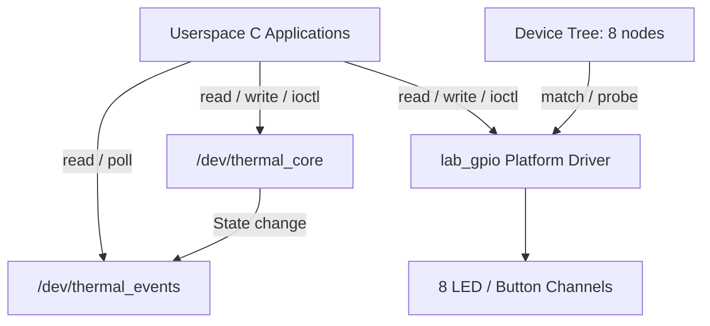

# Linux System Programming & Device Drivers

**C 기반 시스템 프로그래밍에서 시작해, Raspberry Pi 4B의 8채널 GPIO 제어까지 확장한 프로젝트입니다.**

파일 I/O와 프로세스·스레드 실습을 바탕으로 커널 메모리 관리, 이벤트 기반 Character Driver, Device Tree 기반 Platform Driver를 구현했습니다. 사용자 공간 앱과 커널 인터페이스를 함께 구성하고, 실장비에서 LED·버튼 동작과 장치 재바인딩을 확인했습니다.

**C / Linux Kernel / ARM64 / Raspberry Pi 4B / Device Tree / Yocto**

## 핵심 구현

| 영역 | 구현 내용 | 소스 |
|---|---|---|
| **8채널 GPIO 제어** | 하나의 모듈로 8개 Platform Device 바인딩, 채널별 Character Device와 독립 상태 관리 | [Platform Driver](ch07-platform-gpio/driver/lab_gpio.c) |
| **이벤트 기반 I/O** | 상태 변경 이벤트, 8개 이벤트를 저장하는 Ring Buffer, Wait Queue, blocking/nonblocking read, `poll` | [Character Driver](ch06-character/driver/thermal_core.c) |
| **장치 수명 관리** | `kref`로 열린 FD의 수명 유지, `mutex`로 I/O와 remove 직렬화 | [GPIO 수명 관리](ch07-platform-gpio/driver/lab_gpio.c) |
| **사용자 공간 제어** | 8채널 샘플링·디바운스·LED 토글, 백그라운드 실행, Unix Domain Socket 기반 종료 제어 | [C 제어 앱](ch07-platform-gpio/userspace/lab_gpio_test.c) |
| **실패 복구** | 메모리 할당 단계별 실패 주입과 역순 자원 해제 | [커널 메모리 실습](ch05-memory/chain_lab.c) |

## 실장비 검증

| 항목 | 결과 |
|---|---|
| **8채널 구성** | `lab_gpio.ko` 하나로 8개 Platform Device 바인딩 및 8개 Character Device 독립 제어 |
| **LED·버튼 연동** | 8채널 실물 입출력과 `all toggle start/stop` 동작 확인 |
| **반복 재바인딩** | 기존 1채널에서 `unbind/rebind` **20회** 확인 |

[Chapter 07 검증 기록](ch07-platform-gpio/CH07_VERIFICATION.md) · [구현 및 설계](ch07-platform-gpio/CH07_IMPLEMENTATION.md)

## 인터페이스 구성

`thermal_core.ko`는 상태 제어와 이벤트 수신용 장치를 제공하고, `lab_gpio.ko`는 Device Tree의 채널 정의에 따라 GPIO 장치를 생성합니다.



## 설계 포인트

| 판단 | 구현 |
|---|---|
| **장치마다 상태와 수명 분리** | Platform Device별 구조체에 GPIO descriptor·mutex·참조 카운트를 보관하고, 제거 후 기존 FD의 I/O는 `ENODEV`로 처리 |
| **이벤트 처리 정책 명시** | 상태가 바뀔 때 sequence·timestamp를 기록하고 대기 reader를 깨움. 큐가 가득 차면 가장 오래된 이벤트를 교체하며, 여러 reader가 공유 큐를 나누어 소비 |
| **UAPI 입력 계약 유지** | 고정 너비 정수와 16바이트 상태 구조체 사용. ABI 버전·reserved 필드·명령 크기·사용자 포인터 검사 |
| **제어와 관찰 분리** | 토글 컨트롤러는 스캔 후 20 ms 간격으로 다음 스캔을 예약하고 3회 연속 입력을 확인. `watch`는 100 ms 간격으로 읽고 10회마다 출력 |
| **오류 발생 시 자원 정리** | 초기화 실패는 역순 해제 경로로 복구. 토글 앱의 채널 오류는 그룹 종료와 각 채널의 OFF·close 처리로 연결 |

## 소스 구성

| 경로 | 내용 |
|---|---|
| [02a](02a/) | 파일 I/O, `EINTR`, 잘못된 FD, partial write |
| [02b](02b/) | `fork/execve`, Copy-on-Write, `mmap`, 프로세스 간 공유 메모리 |
| [02c](02c/) | pthread, race condition, mutex, AArch64 ABI |
| [ch05-memory](ch05-memory/) | 커널 메모리 할당, 단계별 실패 주입, 자원 수명 관리 |
| [ch06-character](ch06-character/) | Character Driver, ioctl/UAPI, 이벤트 큐, Wait Queue, poll |
| [ch07-platform-gpio](ch07-platform-gpio/README.md) | Device Tree, Platform Driver, 8채널 GPIO, 사용자 공간 제어 앱 |

<details>
<summary><strong>테스트 프로그램 안내</strong></summary>

| 프로그램 | 검사 항목 |
|---|---|
| [thermal_test](ch06-character/userspace/thermal_test.c) | read/write, 길이·값 검사, 부분 read·EOF, EFAULT |
| [thermal_ioctl_test](ch06-character/userspace/thermal_ioctl_test.c) | RESET·GET·SET, ABI 버전·reserved 필드, errno, 기존 I/O 회귀 |
| [thermal_event_test](ch06-character/userspace/thermal_event_test.c) | 이벤트 큐, blocking/nonblocking read, poll, overflow, 경쟁 reader |
| [stress 테스트](ch06-character/stress/) | 부하, 다중 producer/consumer, overflow, 이벤트 전달 지연 |
| [GPIO selftest·hold](ch07-platform-gpio/userspace/lab_gpio_test.c) | GPIO UAPI, 공유 상태, 잘못된 입력, unbind 이후 기존 FD |
| [8채널 mock 테스트](ch07-platform-gpio/tests/test_toggle_eight.py) | 독립 토글, 디바운스, 중복 실행, 오류·시그널 종료 처리 |
| [DT 오프라인 검사](ch07-platform-gpio/tests/check_eight_offline.py) | 병합된 DT의 노드 8개, GPIO 16개, 극성·phandle |

</details>

<details>
<summary><strong>환경 및 빌드</strong></summary>

| 구분 | 환경 |
|---|---|
| Target | Raspberry Pi 4 Model B / AArch64 |
| Driver 기준 커널 | Linux 6.18.33-v8 |
| Host | WSL / Linux x86-64 |
| Cross Build | 기존 Yocto toolchain·target sysroot·kernel artifacts |
| 주요 도구 | GCC, Make/Kbuild, BitBake, dtc, fdtoverlay |

Chapter 07 빌드는 저장소 루트에서 실행합니다.

```sh
# 커널 모듈·앱·단일 채널 Overlay
bash ch07-platform-gpio/scripts/build-existing.sh

# 앱·8채널 Overlay 및 DT 오프라인 병합 검사
bash ch07-platform-gpio/scripts/build-eight-existing.sh
```

기본 Yocto 경로는 `$HOME/study/rootfs/yocto/bitbake-builds/poky-wrynose`이며, `YOCTO` 환경 변수로 변경할 수 있습니다.

모듈과 Overlay가 적용된 Pi에서는 다음과 같이 실행합니다.

```sh
./lab_gpio_test all toggle start
./lab_gpio_test all toggle status
./lab_gpio_test all toggle stop
```

저장소 Overlay는 `disabled` 템플릿입니다. 장비 배선·극성·GPIO 점유를 확인한 뒤 활성화해 적용합니다. 세부 절차와 개별 채널 명령은 [Chapter 07 README](ch07-platform-gpio/README.md)를 참조합니다.

</details>

## 관련 프로젝트

[yocto-rpi4-lab](https://github.com/triton0305/yocto-rpi4-lab) — 이 저장소의 GPIO 드라이버·Device Tree Overlay·C 앱을 Yocto 이미지와 자동 실행 서비스로 통합한 프로젝트입니다.
